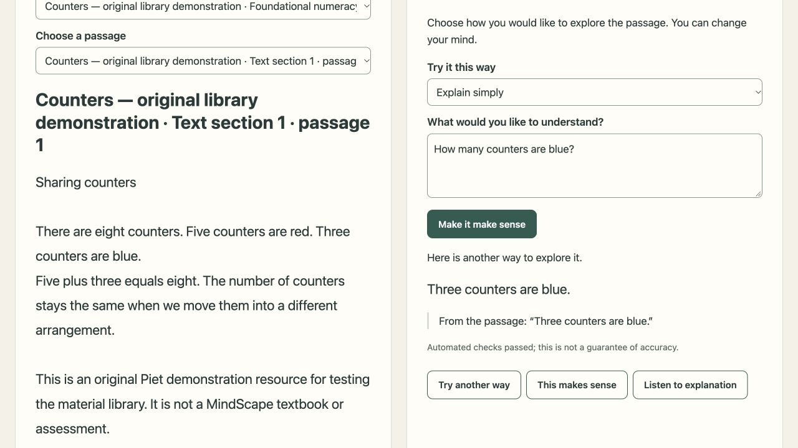
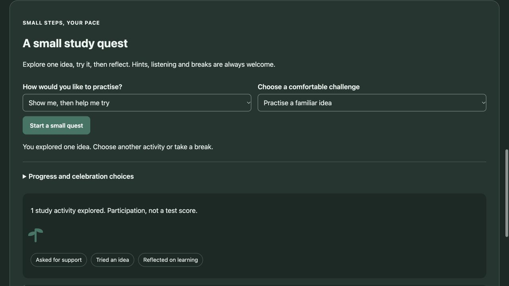

# Piet Educator

**Private learning support. One idea at a time.**

Piet Educator is a local-first learning assistant being developed for children,
teenagers and adults, with a focus on the reading and explanation needs of
neurodivergent learners, particularly people with ADHD and dyslexia.

A learner can open an approved passage, hear it read aloud, adjust its appearance,
ask a question, and choose **Make it make sense** to explore the same idea through
simpler wording, smaller steps, an everyday example or a description of a picture.
The aim is to make learning material easier to approach while retaining the
original meaning and keeping its source visible.

**Current stage: supervised development prototype.** The core reader, local model,
reviewed material library and Windows setup are implemented. Educator review,
broader learner testing and stronger account controls are still needed before
independent use by children. This is an educational aid; diagnosis, clinical
therapy and medication advice are outside the current product.



*The screenshot uses an original Piet demonstration resource, not a licensed
MindScape book or a real learner's work.*

## Who it is being built for

- **Learners who need a different explanation:** choose another approach without
  pressure to keep pace with someone else.
- **Readers who want audio or presentation choices:** listen, change text size or
  line spacing, and select a comfortable font or page theme.
- **Adults working on foundational material:** use simpler explanations while
  retaining respectful adult language. Reading grade and age settings are separate.
- **Parents, educators and facilitators:** add permitted learning material, check
  its text against the original, and approve passages for suitable age groups.

These are design goals and supported interactions, not evidence of clinical
benefit or a promise that one method works for every person.

## Features available now

| Feature | What you can do | Current boundary |
| --- | --- | --- |
| Local AI explanations | Use Ollama and downloaded Qwen 3 8B weights on your computer | Hardware affects speed; setup needs internet |
| Make it make sense | Choose plain explanation, steps, an example, a verbal picture or an understanding question | Responses must pass checks; some useful retries are still withheld |
| Six study methods | Recall, review, teach-back, worked practice, a verbal concrete scene and a small mission | Source-checked practice guidance, not automatic marking |
| Small study quests | Explore → Try → Reflect, with optional covering, hints, answer support and untimed breaks | Activities stay in memory and can expire; no timed pressure |
| Gentle gamification | Optional participation achievements, a static garden or quiet/no celebration | No speed rewards, streak penalties, leaderboards or mastery scores |
| Voluntary review list | Choose to revisit an idea in one, three or seven days | In-memory by default; opt-in browser saving, no reminders or adaptive algorithm |
| Read-aloud | Listen to passages and checked explanations with adjustable speed | Local English system voice required; highlighting depends on voice events |
| Reading preferences | Adjust text size, line spacing, font and warm/plain/dark theme | Saved in this browser; no individual learner profiles yet |
| Optional Dyslexie font | Select a separately licensed font already installed locally | Font is not bundled; fallback font is used if unavailable |
| Material library | Import PDF, EPUB, DOCX, UTF-8 text and Markdown | Text extraction only; one file per upload, up to 20 MB |
| Passage review | Correct extracted text, compare the original, choose ages and approve | Approval is a human review decision, not automatic curriculum certification |
| Source references | See a book/edition and page or section reference with an exact excerpt | Questions use the selected passage, not a search across the entire book |
| Age settings | Run a space for ages 6–9, 10–12, 13–17 or adults | One setting per server; not verified age assurance |
| Private library management | Use a separate owner code for drafts, originals and approvals | Shared-code capability, not parent/teacher accounts |
| Persistent local books | Keep originals, corrections and review history across restarts | Application does not encrypt the library |
| Windows setup | Install requirements, download the model and create desktop/Start menu shortcuts | Source installer for x64 Windows; interactive desktop smoke test pending |

## Feature examples

The following examples illustrate the intended interaction. Generated wording may
vary. A response is displayed only if its checks pass.

### 1. Make a sentence make sense

**Passage:** “I was going to the shop.” The demonstration material explains that
this happened in the past and does not establish whether the speaker arrived.

**Learner:** “Does this prove the speaker arrived?”

**Example explanation:** “No. It tells us the speaker was on their way to the
shop. It does not tell us whether they got there.”

Choose **Break it into steps** to explore who is speaking, what was happening,
where they were going and when. **Describe a picture** gives a written description
of a scene; it does not generate an image. **Try another way** carries the last
checked explanation into the next request and cycles to a different method.

### 2. Ask about a resource you added

**Original demonstration passage:** “There are eight counters. Five counters are
red. Three counters are blue.”

**Learner:** “How many counters are blue?”

**Verified browser example:** “Three counters are blue.”

Piet displayed the same phrase as its source excerpt, alongside the resource's
edition and section reference. This flow was tested through upload, draft review,
approval, reader refresh and a local-model answer.

### 3. Listen and adjust the reading space

Choose **Listen to this passage**, reduce reading speed, and increase text size
or line spacing. Choose **Listen to explanation** after a checked answer appears.
If a local voice emits word-boundary events, Piet highlights the word being spoken.
If no local English voice is available, the reader explains that a voice needs to
be installed. Voice questions and dictation are still planned.

### 4. Review a worksheet before a child sees it

An owner uploads a permitted worksheet and enters its provider, curriculum,
grade, subject, language and edition. It first appears as draft passages. The
reviewer corrects extraction errors, checks the original, selects suitable ages
and approves each passage. A learner sees only approved passages for the running
age setting. Saving a passage as draft withdraws it from new learning requests.

### 5. Keep age and learning level separate

An adult can use a foundational numeracy passage in the adult space. Choosing
**Explain simply** does not switch to a child age policy. A younger learner does
not gain access to adult-only passages by changing a reading preference or
asking Piet to ignore the age setting.

### 6. Practise without pressure

Choose the original **Sharing equally** passage, then **Help me remember** and
start a small quest. Explore the passage, select **Ready to try**, and answer,
ask for a hint or choose **Show me**. All support paths can finish the same
Explore → Try → Reflect flow and receive equal participation credit.

Choose **Let me teach you** to explain reasoning, or **Show me, then help me try**
for a worked example and labelled practice. You can pause without a countdown,
turn off achievements or choose a quiet display. Optional review dates are choices,
not deadlines. No learner response is saved in browser progress storage.

See [study methods and gentle gamification](docs/STUDY-METHODS.md) for the six
methods, privacy controls, review list, expiry and current limits.



*Demonstration participation only; these are not learner assessment results.*

## Start using Piet

### Windows

Download this private repository's ZIP while signed into GitHub, choose
**Extract All**, then double-click **Install-Windows.cmd**. Setup checks Python
and Ollama, installs missing requirements through WinGet where available, downloads
the local model and creates Piet Educator shortcuts.

See [Windows installation and transfer guide](WINDOWS-INSTALL.md) for the full
steps, private library location, age settings and troubleshooting. The first model
download is approximately 5.2 GB; ordinary reading and explanations then use local
resources. This is a source installer, not a signed MSI or Store app.

### macOS/Linux source launch

Install Python 3.9+ and Ollama, then run the following from the repository folder:

```sh
python3 -m pip install -r requirements.txt
ollama pull qwen3:8b
ollama create piet-educator -f Modelfile
python3 server.py --model piet-educator --judge-model qwen3:8b
```

Open `http://127.0.0.1:8767`. The default age band is `6-9`; the owner can launch
with `--age-band 10-12`, `--age-band 13-17` or `--age-band adult`. Source launches
store books in `data/` unless `--data-dir` selects another folder.

The named model is a configuration of Qwen, not newly trained educational weights.
The application adds the teaching policy and validation; running the model alone
does not enable the application's safeguards.

## Add learning material

**Upload → review → approve suitable ages → refresh the reader.**

The owner library is at `http://127.0.0.1:8767/library`. A source launch prints its
owner code; Windows desktop launches keep it in
`%LOCALAPPDATA%\PietEducator\data\owner-key`. It is never supplied in a learner
session. Lock the library when finished.

See the [material library guide](docs/MATERIAL-LIBRARY.md) for formats, review,
manual transcription, withdrawal, limits, and backup. Scanned pages need manual
transcription today; automatic OCR and diagram interpretation are not implemented.

## Curriculum direction

Our first selected provider is **MindScape Education**, with **CAPS** as the
curriculum framework. These remain separate metadata fields. Book access,
specific editions, topic sequences and curriculum outcome mapping are pending.
No MindScape books are included and no affiliation or integration is claimed.

See [curriculum scope](CURRICULUM.md). Although the provider covers Grade R through
matric, Piet's current age settings begin at 6. Early-years support requires its
own reviewed design.

## Privacy, age settings and validation

The application contacts a fixed loopback Ollama endpoint, uses local system
voices, and has no cloud explanation fallback. Initial dependency/model downloads
need internet. Questions and answers stay in memory for the current visit;
presentation preferences use browser storage. Books and material-review history
persist locally. Study participation/review references stay in memory unless the
learner explicitly opts into browser saving; typed responses are not saved there.
No application prompt logs, recordings or analytics are collected.

Before a generated explanation is shown, Piet checks its structure, length and
source excerpt, then requests a semantic review of safety, age suitability,
grounding, meaning and privacy. Missing services, malformed reviews or failed
checks withhold the generated answer. Exact quotation is not proof of correctness,
and the review can use the same underlying model with the same blind spots.

The owner code is not a verified parent identity. Shared-device account isolation,
more complete safeguarding flows and independent review remain open work. The
loopback server is intended for controlled local development, not a school-network
or multi-user deployment. See [privacy and validation](docs/PRIVACY-AND-VALIDATION.md).

## What is still planned

Offline dictation and voice questions; OCR and visual material handling; fuller
curriculum mapping and book retrieval; protected owner/learner accounts; bookmarks
and reviewed mastery measures; authenticated private progress profiles, adaptive
review scheduling, broader accessibility and learner testing; and
professional review of any future therapy-support content.

These are roadmap items, not current features. See [roadmap](ROADMAP.md) for
priorities and the readiness work needed before a learner pilot.

## Documentation and verification

| Guide | Purpose |
| --- | --- |
| [Learner and facilitator guide](docs/USER-GUIDE.md) | Everyday use and realistic example prompts |
| [Study methods and gamification](docs/STUDY-METHODS.md) | Small quests, hints, optional rewards, review dates and saving controls |
| [Material library](docs/MATERIAL-LIBRARY.md) | Import, source review, age approval and backup |
| [Windows installation](WINDOWS-INSTALL.md) | Setup, shortcuts, updates and Mac-to-Windows transfer |
| [Privacy and validation](docs/PRIVACY-AND-VALIDATION.md) | Local data, checks and their limits |
| [Curriculum scope](CURRICULUM.md) | MindScape/CAPS direction and pending materials |
| [Architecture](docs/ARCHITECTURE.md) | Components, request flow and storage boundaries |
| [Validation record](VALIDATION.md) | Evidence and outstanding target-device checks |
| [Roadmap](ROADMAP.md) | Implemented foundation and planned work |
| [Change history](CHANGELOG.md) | Record of shipped changes |
| [Contributing and documentation upkeep](CONTRIBUTING.md) | Required checks and which guides to update |

The current study slice has **63 Python application tests** and **7 JavaScript
participation-state checks**. See the [validation record](VALIDATION.md) for live
model/browser checks and their limits.

The installer foundation suite had **42 tests** and passed on the
[Windows runner for the installer foundation](https://github.com/bitrite/Piet-Educator/actions/runs/42602249169).
That checks application compatibility, installer syntax, payload layout and Python
detection; it does not exercise a complete interactive Windows installation or
certify child safety. Historical live-model and browser checks are recorded in
[VALIDATION.md](VALIDATION.md).

```sh
python3 -m unittest discover -s tests -v
python3 tools/check_docs.py
node --test tests/study-state.test.cjs
```

Feature, installation, data-handling and limit changes must update their supporting
guides in the same change. CI also checks local Markdown links; it does not verify
the truth of documentation claims.
